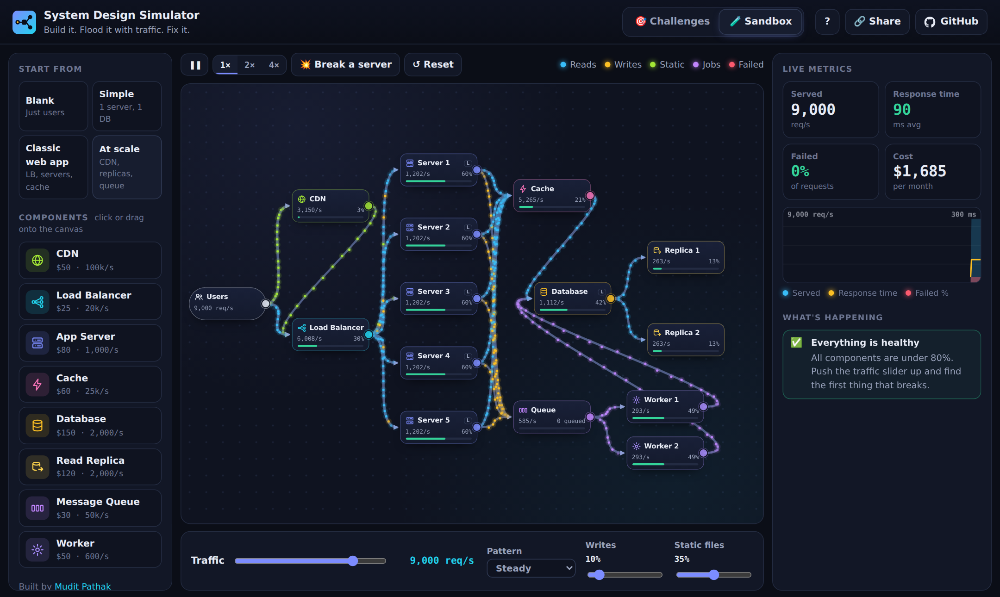
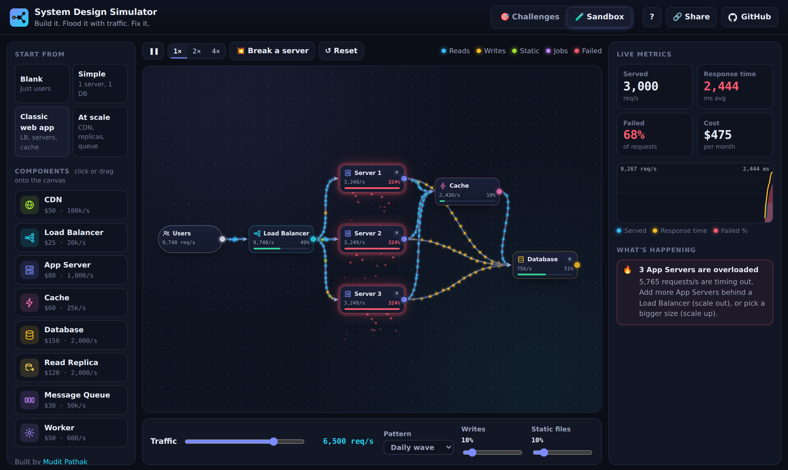
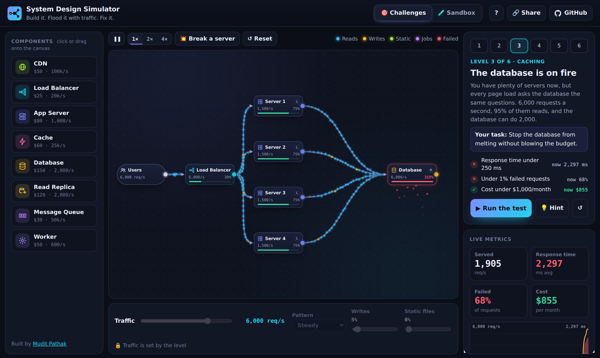
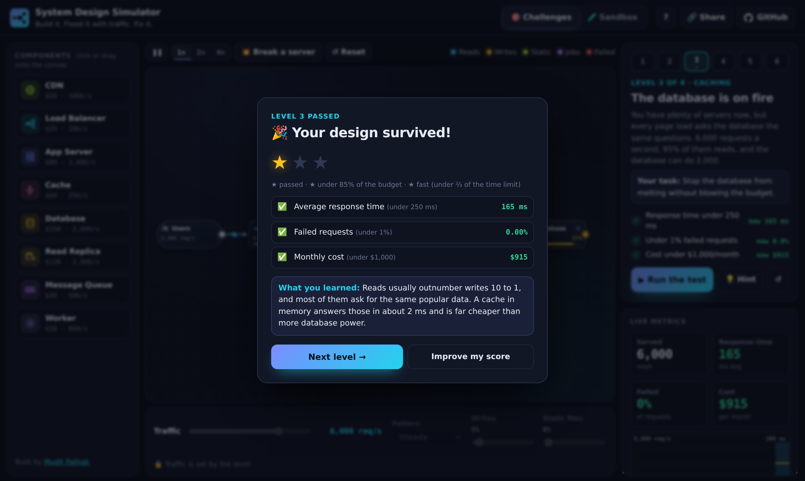

<p align="center">
  
</p>

<h1 align="center">System Design Simulator</h1>

<p align="center">
  <b>Build an architecture. Flood it with traffic. Watch it break. Fix it.</b><br>
  An interactive playground where you learn system design by doing, not by memorising diagrams.
</p>

<p align="center">
  <a href="https://mudit2308.github.io/system-design-simulator/"><b>▶ Play it live</b></a> ·
  <a href="#the-6-challenges">Challenges</a> ·
  <a href="#how-the-simulation-works">How it works</a>
</p>

<p align="center">
  <a href="https://github.com/mudit2308/system-design-simulator/actions/workflows/ci.yml"></a>
  
  
  
  
</p>



## What is it?

System design is usually taught with static boxes and arrows. Here the boxes are alive.

Drag **servers, load balancers, caches, databases, read replicas, CDNs, message queues and workers** onto a canvas and connect them. Thousands of requests per second flow through your design as animated particles. Every component has a **real capacity, latency and monthly cost**, so when you push the traffic up you see exactly what breaks first, why, and what it costs to fix.

## Features

- **Live traffic simulation.** Reads, writes, static files and background jobs flow through your design in real time, colour-coded.
- **Things break realistically.** Components near 100% get slow, then requests start timing out. Overloaded components glow red and drop requests as red sparks.
- **Chaos button.** Crash your busiest server and see whether your load balancer saves you, or whether you built a single point of failure.
- **Plain-English explanations.** A "What's happening" panel tells you what's wrong and what a senior engineer would do about it.
- **Costs and trade-offs.** Every component has a monthly price. Scale up (a bigger machine) or scale out (more machines)? A cache or a read replica? You decide, within budget.
- **6 challenges with star ratings** that go from your first server to designing a Big Billion Day sale from scratch.
- **Sandbox mode** with templates, traffic patterns (steady, daily wave, flash spikes) and a read/write/static mix.
- **Share links.** One click copies a URL that opens your exact design.
- **Works on mobile and with the keyboard.** Arrow keys move components, Enter opens details, Delete removes, and every connection can be made from a menu.



## The 6 challenges

| # | Level | Concept you learn |
| --- | --- | --- |
| 1 | Your first website | Client → server → database |
| 2 | You went viral | Horizontal scaling with a load balancer |
| 3 | The database is on fire | Caching |
| 4 | Servers crash. Stay up. | Redundancy (N+1) and health checks |
| 5 | Flash sale checkout | Message queues for bursty writes |
| 6 | Big Billion Day | CDNs, and putting it all together |

Each level is graded by a 20-second test against three goals: **response time**, **failed requests** and **monthly cost**. Bonus stars for coming in well under budget and being fast. Every level is designed so the "obvious" answer fails. For example, a bigger database alone won't save level 3, and two large servers aren't enough redundancy for level 4.





## How the simulation works

The engine (`js/engine.js`) is plain JavaScript with no DOM, so it runs in both the browser and Node tests.

- **Fluid model.** Every 100 ms tick, each request type (read, write, static, job) flows through the graph as an amount, not as individual objects. That's how it can simulate 50,000 requests per second smoothly in a browser.
- **Capacity and queueing.** Each component processes up to its capacity per second. Anything above that waits in a backlog. Waiting adds latency, and after 2 seconds requests time out and fail. Response time also rises as utilisation approaches 100%, the way real systems behave (a simple queueing-theory curve).
- **Exact latency accounting.** Each flow carries its accumulated latency along with it, so the average response time is exact for the model, including network hops (users → CDN edge is faster than users → origin).
- **Real component behaviour:**
  - Load balancers health-check servers and stop sending to a dead one after about 2 seconds.
  - Caches answer hits and pass misses to the database. Both read-through and cache-aside wiring work.
  - Databases share reads with their read replicas by capacity. Writes cost twice as much as reads and only go to the primary.
  - Queues accept writes instantly. Workers pull jobs at their own pace, so spikes are smoothed out before they reach the database.
  - CDNs serve 95% of static files at the edge.
- **Deterministic grading.** The same design always gets the same score, which makes the challenges fair and testable.

```
js/
├── engine.js       The traffic simulation (pure logic)
├── components.js   Capacities, latencies, costs and descriptions of every component
├── challenges.js   The 6 levels and the grader
├── insights.js     Turns numbers into plain-English advice
├── templates.js    Sandbox starting points
└── app.js          Canvas, drag and drop, particles, charts, UI
```

## Tests

```bash
npm install
npm test           # 32 engine and level tests
npm run test:e2e   # 4 browser tests with Playwright
```

The level tests don't just check that the code runs. They prove every level is **solvable** (a reference design passes), that every **starting design fails**, and that the common wrong answers fail too. Browser tests play level 1 like a real user: drag a database onto the canvas, connect it, run the test and pass with 3 stars. Everything runs on every push with GitHub Actions.

## Run it locally

No build step, no framework, no dependencies.

```bash
git clone https://github.com/mudit2308/system-design-simulator.git
cd system-design-simulator
npm start          # then open http://localhost:3000
```

## Disclaimer

The numbers are simplified, rounded and realistic in proportion, not benchmarks. Real capacity depends on your code, queries, hardware and much more. The goal is to build intuition for *why* systems are designed the way they are.

## License

[MIT](LICENSE) © 2026 [Mudit Pathak](https://github.com/mudit2308)
